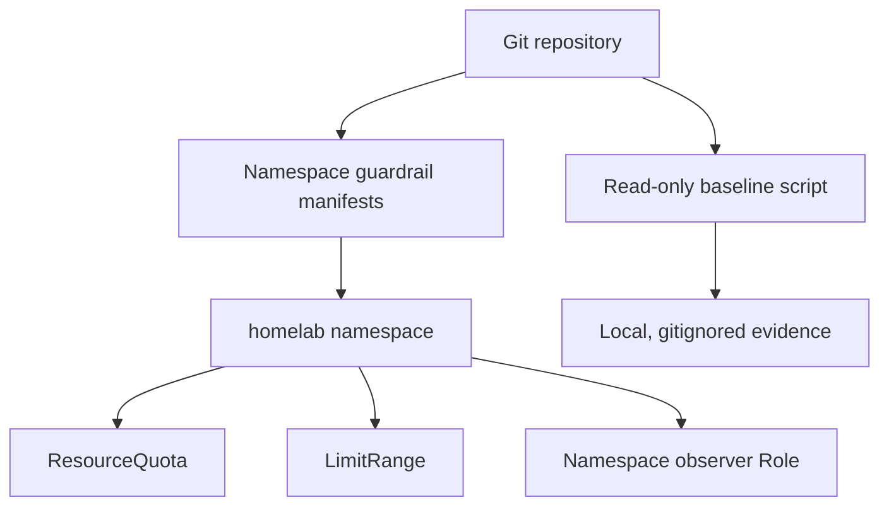

# Project 01 — Cluster foundation & baseline

**Status:** Complete  
**Objective:** Create an auditable, resource-aware starting point for all subsequent K3s projects without disturbing existing workloads.

## Current baseline

- Cluster context: `cl1`; K3s: `v1.36.5+k3s1`.
- Nodes: `cp01` (control plane), `wk01`, `wk02`, and `wk03` (workers), all `Ready`.
- CNI: Cilium. Storage: default `local-path` plus `nfs-csi` for shared/persistent workloads. Ingress is not yet installed.
- Full inventory and a dated resource snapshot are maintained in [docs/ENVIRONMENT.md](docs/ENVIRONMENT.md).

## Scope

1. Capture a repeatable read-only health snapshot.
2. Create a dedicated `homelab` namespace with Pod Security Admission labels.
3. Apply safe resource guardrails in that namespace: a `ResourceQuota` and `LimitRange`.
4. Provide a namespace-scoped observer role as a least-privilege RBAC example. A binding is deliberately deferred until an actual identity exists.
5. Validate the manifests against the API server and record redacted evidence.

## Architecture



## Design decisions and trade-offs

| Decision | Why | Trade-off |
| --- | --- | --- |
| Namespace-scoped guardrails | Demonstrates multi-tenancy fundamentals without affecting `kube-system` or existing Cilium tests. | It does not protect workloads outside `homelab`. |
| Pod Security `baseline` enforcement | Blocks clearly unsafe pod settings while keeping the initial lab practical. | `restricted` offers stronger isolation and will be evaluated when applications are introduced. |
| Conservative default resources | Prevents accidental exhaustion on 4 GB nodes. | Workloads requiring more capacity must declare and justify their values. |
| No RBAC binding yet | Avoids granting permissions to an invented or overly broad identity. | The role is a pattern until an actual developer/service-account identity is introduced. |

## Deploy

Prerequisite: use the intended context, then review the diff.

```powershell
kubectl config current-context
kubectl apply --dry-run=client -k ./manifests/
kubectl apply -k ./manifests/
```

## Validate

```powershell
kubectl apply --dry-run=server -k ./manifests/
kubectl get namespace homelab --show-labels
kubectl -n homelab get resourcequota,limitrange,role
./scripts/collect-cluster-baseline.ps1
```

## Acceptance criteria

- [x] Every node is `Ready`; baseline health is recorded.
- [x] Existing Cilium validation namespaces are identified and excluded from change scope.
- [x] Manifests pass server-side dry-run and create only `homelab` namespace resources.
- [x] A post-apply snapshot confirms quota, limits, and RBAC role.
- [x] Redacted evidence is committed; raw command output remains local.

## Rollback and troubleshooting

All resources created by this project are namespaced. To remove them, first confirm `homelab` contains no required workloads, then run:

```powershell
kubectl delete -k ./manifests/
```

If `kubectl top nodes` fails, confirm the metrics-server pod in `kube-system` is healthy before treating it as a workload issue.

## What I learned

- Kubernetes `LimitRange` is evaluated at admission time; a server-side dry-run safely proved that a 2-CPU container is rejected by this namespace's 1-CPU maximum.
- The same admission path injects the documented `100m` CPU / `128Mi` memory requests and `500m` CPU / `512Mi` memory limits when a workload omits resources.
- `baseline` Pod Security enforcement rejects privileged containers, while `restricted` audit/warn labels expose hardening gaps before that stricter profile becomes mandatory.
- A namespace `ResourceQuota` is a useful shared budget, while `LimitRange` prevents an individual container from bypassing sensible defaults.
- Cilium validation namespaces should be treated as pre-existing cluster work and explicitly excluded from unrelated platform changes.

